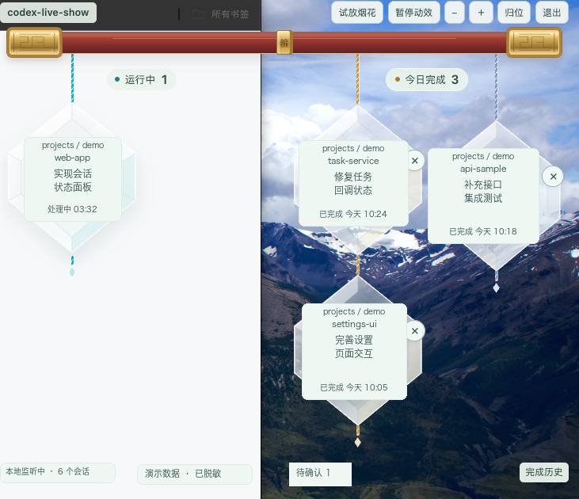
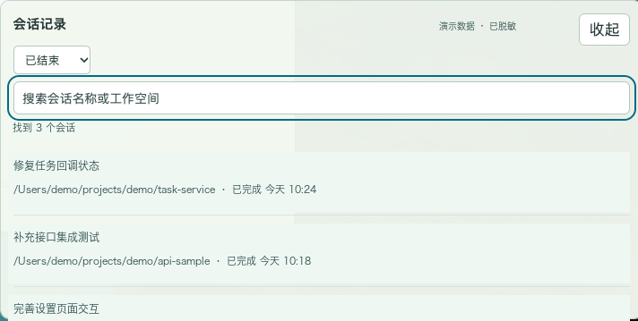

# codex-live-show

macOS Apple Silicon 桌面透明挂件。水晶挂件与三栏看板可来回切换，均可收成屏幕边缘的会话抽屉。每两秒读取本地 Codex 状态，完成记录保存在本机。

## 界面预览

以下截图中的会话名称、工作空间路径、用户名、时间与统计数量均已替换为演示数据。

### 桌面会话挂件



### 会话历史查询



## 启动

双击 `dist/codex-live-show.app`，或运行：

```sh
open "dist/codex-live-show.app"
```

首次默认收起在主屏右边缘，点击“会话”展开；抽屉底部按钮切换左右停靠。随后记住布局、抽屉状态、展开位置和缩放。收起的小抽屉位于普通窗口上方，并显示执行中／待确认／今日完成数量；展开后默认贴在桌面、位于普通软件窗口下方；顶部“置顶”按钮可切换为始终置顶，再点“取消置顶”恢复桌面模式，重启后保留选择。应用驻留菜单栏，不占 Dock。

- 按住左上角带拖动标识的标题移动窗口；看板顶部从标题到右侧操作按钮之间的空白也可拖动，水晶布局也可拖动金箍棒。拖动时暂停自动布局，松开后记住新位置；棒身获得键盘焦点后，方向键移动，Shift 加速，Home/Enter 归位。

金箍棒采用指针拖动，不再借用系统标题栏：单击/双击不会切换页面、归位或进入全屏；移动超过4像素才开始拖动。拖动时锁定鼠标接收，松开后恢复空白区域穿透。macOS使用非激活面板，避免点挂件时切换前台应用。
- 双击水晶或历史记录，直接打开对应Codex对话；单击不执行打开操作，键盘可按Enter打开。使用系统注册的 `codex://threads/<id>`，不显示详情面板。

macOS点击跳转会明确唤起本机ChatGPT/Codex应用，避免依赖不确定的系统协议处理；打开前检查本地会话索引，已删除的记录会显示错误。按下卡片期间会暂缓状态刷新，避免实时更新打断点击。

“打开会话”和“定位到最新消息”是两件事：Codex当前公开深链接没有跳至最新消息的参数，应用可能恢复自己保存的阅读位置；此挂件不修改Codex安装包或其滚动状态数据，因此不能保证强制滚到底部。
- “切换看板／切换挂件”可往返切换。水晶布局每组保持双列、每页最多4张卡片并支持翻页；三个栏目同时展开时自动加宽；看板按列滚动。两种布局共享数据和隐藏记录。
- 三栏为执行中、待确认、已完成，分别按最近状态更新时间／完成时间倒序排列。空栏始终自动折叠，即使之前手动展开过也不占整栏宽度；点击空栏目显示说明，有数据时展开；点击栏目标题也可手动折叠。各栏按自身内容定高，长列表在栏内滚动；三栏全部折叠时变为紧凑状态条。看板按展开栏数自适应宽度：0/1/2/3栏分别约360/440/700/920像素（100%缩放），高度跟随内容；全部折叠时保留标题拖动、数量和抽屉入口。
- “收起抽屉”或 Esc 将整个窗口收至侧边；手动收起后，新数据只更新数量，不自动抢占屏幕。待确认数量大于零时抽屉显示暖色提示。
- 执行中和待确认任务跨天保留；待确认明确区分“需要输入”和“需要审批”。
- 挂件完成区只显示上海时区当天完成的会话；跨过午夜会自动刷新。已完成卡片旁的 × 可从挂件移除，重启后保持隐藏，历史记录仍可查。同一会话再次完成时会重新显示。
- “完成历史”可查询结束记录；“状态未知”可查询没有明确生命周期事件的记录，不混入需要用户处理的待确认栏。搜索匹配完整标题和工作空间，历史最多显示200个匹配项。
- “更多”展开缩放 + / −、置顶、动效、归位、历史和退出等操作；全部折叠时也可从“更多”切回水晶挂件。
- 水晶布局的透明空白区域鼠标穿透，卡片和按钮可以操作；看板和侧边抽屉完整接收鼠标，点击空白不会落到桌面。系统“减少动态效果”开启时默认暂停动效。

## 完成烟花

新任务明确完成后，按选择的屏幕范围播放一次约5秒的金砂烟花：8朵烟花分组绽放、1960颗金砂与碎晶粒子、600片彩花分三批飘落。默认“当前屏幕”：跟随挂件所在屏幕。打开“更多”，点击“烟花：当前屏幕／所有屏幕”可往返切换并跨重启保存；“所有屏幕”覆盖每次播放时连接的所有显示器，只有一块屏幕时仍正常播放。更改范围从下一次播放生效，试放也使用相同范围。覆盖层鼠标穿透、不抢焦点，无文字提示、背景遮罩、闪白或声音，播放后自动关闭。

启动时的历史记录不补播；相同完成事件不重播；中断/未知状态不触发。短时间完成的多个任务合并为一次，播放期间不叠加新覆盖层。

菜单栏挂件图标中提供：

- 顶部“试放烟花”：立即试播完整烟花和彩色纸屑。
- 庆祝动效 → 跟随系统：系统减少动态效果开启时，替换为900ms无位移金色光点。
- 庆祝动效 → 完整烟花：默认模式，播放完整烟花和彩色纸屑。
- 庆祝动效 → 关闭完成动效：关闭自动庆祝。
- 预览完成动效：手动试播。

顶部“暂停动效”同时暂停自动庆祝。手动预览允许查看当前模式效果。

完成触发直接消费明确的task_complete/Stop事件；即使同一次轮询中随后又开始下一轮任务，也会保留完成通知。独立完成时间戳集合负责去重。

## 状态来源

优先只读 `~/.codex/state_5.sqlite` 中 `originator=Codex Desktop` 的顶层会话。名称优先使用用户修改后的 `name`，其次使用本地会话索引，最后使用初始标题。CLI、自动化和子代理不混入桌面卡片。

增量读取 rollout JSONL：

| 事件 | 状态 |
|---|---|
| task_started / UserPromptSubmit | 运行中 |
| task_complete / Stop | 没有未回答输入时为已完成，否则保留待确认 |
| request_user_input / request_user_input_async | 待确认·需要输入 |
| 对应同步工具结果 / 异步 questionItemId 回答 | 解除对应输入请求；无剩余请求时恢复执行或已完成 |
| PermissionRequest / PreToolUse、PostToolUse | 待确认·需要审批 / 审批后恢复 |
| turn_aborted / Interrupt | 已中断 |
| SessionStart | 不视为运行开始 |
| SessionEnd | 会话关闭；不视为成功完成 |

挂件的“今日完成”只展示当天已完成且未被移除的会话；已中断与往日记录通过历史查询。没有明确事件的历史记录显示“状态未知”，不按时间猜测成功。相同会话保存最新状态，重新开始处理时回到运行区。

首次向前最多16MiB寻找当前轮次起点并重放，恢复该轮尚未回答的输入；超出边界时退回末尾1MiB和原有边界恢复机制。首次升级会重算可重放轮次的旧状态缓存。之后从文件偏移增量读取。索引查询最多200个最近会话，已保存的桌面记录在本地保留。损坏的持久化文件会原样保留并提示，不覆盖。

## 数据与隐私

数据保存在：

```text
~/Library/Application Support/Codex Session Clothesline/
  sessions.json       会话名称、目录、状态、时间与待回答调用ID（不保存问题或回答正文）
  preferences.json    位置、缩放、布局、抽屉与动效偏好
  inbox/              可选Hooks事件
```

只读 Codex 数据库；不读取认证文件，不上传会话内容。应用不需要账户或网络端口。

## 可选 Hooks

当前已使用本地JSONL事件监听，没有自动修改全局Hooks配置。需要更细的“执行工具/等待审批”阶段时，可在项目目录执行：

```sh
npm run hooks:install
```

安装器会备份 `~/.codex/hooks.json`、保留其他配置并去重。Codex若要求信任新Hooks，需在其Hooks管理界面审核。卸载仅移除本项目条目：

```sh
npm run hooks:uninstall
```

Hooks桥只保存事件名称、会话ID、目录、时间、turn ID和事件文件路径，不保存提示词或回复。

## 开发与检查

需要 Node.js 22+、macOS及系统sqlite3。

```sh
npm install --ignore-scripts
npm run prepare:runtime
npm start
npm test
npm run check
npm run test:drawer
npm audit --registry=https://registry.npmjs.org
npm run pack
```

`prepare:runtime` 使用Electron发布包的校验和验证运行时，以macOS ditto解包。如果直接下载源证书异常，可使用可信镜像的 `ELECTRON_MIRROR`，仍保持SHA-256校验和TLS校验。

`npm run test:drawer` 使用独立临时数据测试 macOS 原生抽屉、缩放、布局切换和移除操作，不改真实偏好；截图和结果位于 `test-artifacts/drawer/`。

`npm start -- --smoke` 使用真实本机监听截图并退出，结果在 `test-artifacts/`。截图可能含会话名称，默认不纳入版本控制。浏览器交互验证服务器为 `node scripts/ui-test-server.cjs`，只监听127.0.0.1，使用明示的测试数据，不是生产应用的组成部分。

## 已知边界

本地JSONL和SQLite格式随Codex版本可能改变，遇到不能识别的状态会提示或进入“状态未知”。待确认只依据明确输入调用和审批事件，不从自然语言猜测；审批识别依赖来源实际发出 PermissionRequest，异步输入的 accepted 回执不算用户回答。应用为本机构建的ad-hoc签名版本，尚未公证；窗口拖动和系统协议实际跳转仍需在用户桌面操作验收。原生操控权限不足时，自动验证覆盖应用截图、真实监听、同源渲染交互和后端状态测试。
